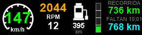

# Trucker Simulator para Ajazz StreamDock

Plugin **Trucker Simulator** (`com.hsgaming.scsmon`): telemetria en vivo de
**American Truck Simulator** y **Euro Truck Simulator 2** en controladoras
Ajazz / StreamDock (AKP153R/E probado; AKP05, AKP03 y demas compatibles —
ver `docs/COMPATIBILIDAD.md`).

Velocidad, marchas, RPM, combustible, ruta, danos y todos los testigos del
tablero, mas botones que actuan sobre el juego (luces, intermitentes,
estacionarias, baliza, limpiaparabrisas, diferencial, freno, crucero).



## Caracteristicas

21 acciones en 2 grupos:

**Monitores** (solo muestran): velocidad (velocimetro), marcha, RPM con aviso
CAMBIA, combustible (surtidor + barra + autonomia), consumo L/100km, crucero,
limite de via con alerta, temperatura motor y aceite, presion de aire, danos
(camion / trailer / carga), ruta (recorrida / faltante + ETA).

**Botones** (muestran estado y actuan): estacionarias (`F`), intermitentes
izq/der (`[` / `]`), luces (`L`), largas (`K`), baliza (`O`),
limpiaparabrisas (`P`, ciclo OFF/A/2/3), bloqueo diferencial (`V`), freno de
emergencia (`Espacio`), crucero (`C`).

Detalles tecnicos: `docs/DESARROLLO.md`. Asignacion de teclas: `docs/INSTALACION.md`.

## Requisitos

- Windows 10/11 (64 bits).
- ATS y/o ETS2 (Steam o instalacion independiente).
- Software StreamDock / Ajazz con el dispositivo conectado.
- `scs-telemetry.dll` de RenCloud (v1.12.x) instalada en cada juego — el
  instalador lo hace solo; no se distribuye en este repo por licencia.

## Instalacion

1. Descarga `TruckerSim-Ajazz-Setup-X.Y.exe` de la seccion Releases.
2. Ejecuta el instalador: detecta ATS/ETS2 en Steam automaticamente. Si tu
   juego **no es de Steam**, usa el boton *Examinar* y apunta a su carpeta.
3. Abre (o reinicia) el software StreamDock: las acciones aparecen en la
   categoria **Trucker Simulator**.
4. En el juego, asigna `F` a estacionarias (Opciones → Teclas; viene sin
   asignar). El resto (`L K O [ ] P V C Espacio`) viene asignado por defecto.

Guia paso a paso con capturas: `docs/INSTALACION.md`.

## Dispositivos compatibles

| Dispositivo | Teclas | Estado |
|---|---|---|
| Ajazz AKP153R / AKP153E | 15 LCD (3×5) | Probado |
| Ajazz AKP05 / AKP05E | 10 LCD + 4 knobs + tira tactil | Compatible (teclas; knobs sin acciones asignadas) |
| Ajazz AKP03 y demas Keypad | LCD | Compatible (acciones Keypad estandar) |

Las acciones son `Keypad` estandar: funcionan en cualquier dispositivo sin
cambios. Detalle: `docs/COMPATIBILIDAD.md`.

## Diagnostico

```bat
backend.exe -Test        :: vuelca valores + PNGs a %TEMP%\scsmon-test
backend.exe -WatchHigh   :: muestrea largas 60 s (probar rafagas)
```

Solucion de problemas comunes: `docs/INSTALACION.md#problemas-comunes`.

## Compilar desde fuente

- Backend: `csc.exe` de .NET Framework, sin dependencias (`docs/DESARROLLO.md`).
- Instalador: Inno Setup 6 (`installer/truckersim-ajazz.iss`).

## Estructura del repo

```text
plugins/com.hsgaming.scsmon.sdPlugin/  Plugin (fuentes: backend.cs, manifest, PI, PNGs)
automatizacion/                        Watcher gaming + lanzador manual
installer/                             Script Inno Setup
docs/                                  Manuales + imagenes
dll/                                   (vacío en git: colocar scs-telemetry.dll aqui para el instalador)
```

## Creditos

- Telemetria: `scs-telemetry.dll` de RenCloud (licencia propia).
- Iconos de testigos: pack `jp.tsuteto.ets2` (solo respaldo local, no incluido).
- Icono del paquete: logo ATS de Steam.

## Licencia

Codigo propio (backend.cs, scripts, instalador, docs): MIT. Los binarios de
terceros quedan excluidos (ver arriba).
